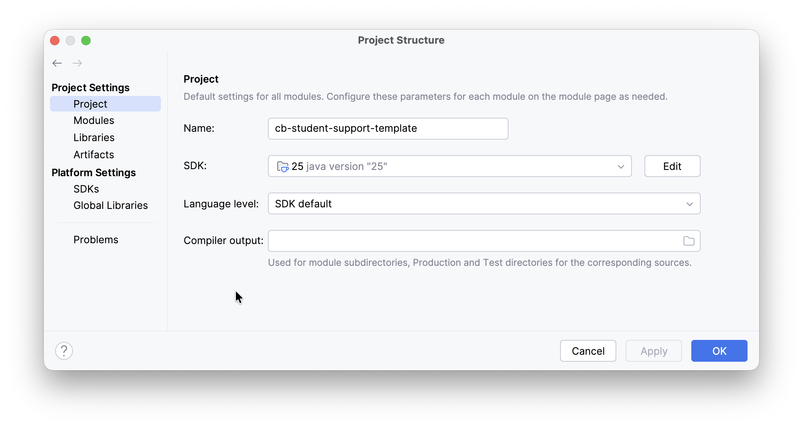
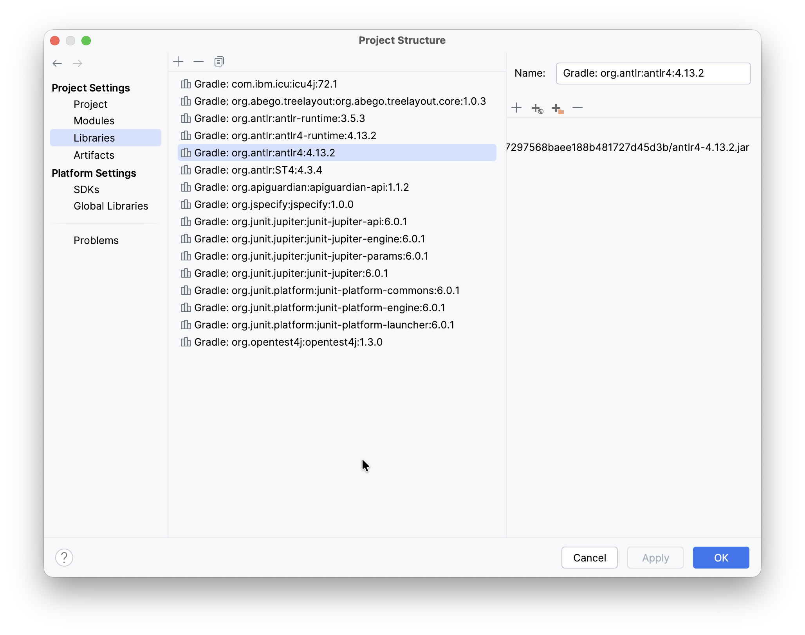
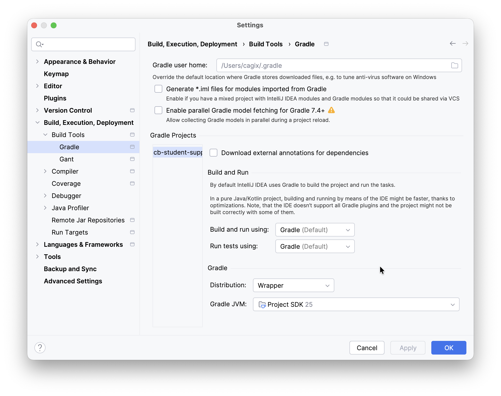

# "Hello World" mit ANTLR (Lexer)

``` antlr
grammar Hello;

start       : 'hello' GREETING ;

GREETING    : [a-zA-Z]+ ;
WHITESPACE  : [ \t\n]+ -> skip ;
```

[Konsole: Hello (Classpath, Aliase, grun, Main, Dateien, Ausgabe)]{.ex
href="https://github.com/Compiler-CampusMinden/CB-Vorlesung-Bachelor/blob/master/lecture/01-lexing/src/Hello.g4"}

:::: notes
## Hinweis zur Grammatik (Regeln)

-   `start` ist eine Parser-Regel =\> Eine Parser-Regel pro Grammatik wird benötigt,
    damit man den generierten Parser am Ende auch starten kann ...
-   Die anderen beiden Regeln (mit großem Anfangsbuchstaben) aus der obigen
    Grammatik zählen zum Lexer

## ANTLR einrichten

-   Lokal für die Nutzung in der Konsole:

    -   Es wird ein JDK benötigt. Installieren Sie am besten die aktuelle
        LTS-Version.
    -   Aktuelle Version herunterladen:
        [antlr.org](https://www.antlr.org/download.html), für Java als Zielsprache:
        ["Complete ANTLR 4.x Java binaries
        jar"](https://www.antlr.org/download/antlr-4.13.2-complete.jar)
    -   CLASSPATH setzen:
        `export CLASSPATH=".:/<pathToJar>/antlr-4.13.2-complete.jar:$CLASSPATH"`
    -   Aliase einrichten (`.bashrc`):
        -   `alias antlr='java org.antlr.v4.Tool'`
        -   `alias grun='java org.antlr.v4.gui.TestRig'`

-   Alternativ für Java-Projekte mit Gradle (empfehlenswert):

        plugins {
            id 'java'
            id 'antlr'
        }

        repositories {
            mavenCentral()
        }

        dependencies {
            antlr 'org.antlr:antlr4:4.13.2'
        }

    Der Eintrag in `plugins` sorgt dafür, dass Gradle beim Bauen des Java-Projekts
    die ANTLR-Grammatiken übersetzt, der Eintrag in `dependencies` lädt automatisch
    das Jar-File für ANTLR herunter und bindet es entsprechend im CLASSPATH ein.

-   Alternativ das [ANTLR tool
    (JAR)](https://www.antlr.org/download/antlr-4.13.2-complete.jar) manuell
    herunterladen und in der IDE als Library hinzufügen (bitte nur als Hilfslösung,
    der Weg über das Build-Tool ist deutlich besser)

-   Im Web ohne lokale Installation: [ANTLR Lab](http://lab.antlr.org/) (nur HTTP)

(vgl.
[github.com/antlr/antlr4/blob/master/doc/getting-started.md](https://github.com/antlr/antlr4/blob/master/doc/getting-started.md))

**Tip**: Für IntelliJ gibt es ein sehr gutes
[ANTLR-Plugin](https://plugins.jetbrains.com/plugin/7358-antlr-v4). Dieses erlaubt
das interaktive Experimentieren mit ANTLR-Grammatiken, ohne dass man ANTLR selbst
installiert haben muss oder Code geschrieben haben muss. Für die Arbeit mit
Grammatiken ist dieses Plugin unbedingt empfehlenswert! (Für das normale Arbeiten
sollten Sie aber die Gradle-Konfiguration nutzen!)

**Hinweis**: Im Beispiel-Projekt
[student-support-code-template](https://github.com/Compiler-CampusMinden/student-support-code-template)
finden Sie ein fertig eingerichtetes Java-Projekt mit Gradle und ANTLR. Sie können
dieses Projekt als Template nutzen und in Ihrer IDE importieren, d.h. Sie brauchen
nur ein installiertes JDK (Version 25 ist die aktuelle LTS) und eine Java-IDE, der
Rest (Gradle, ANTLR) kommt über die Einstellungen im Beispiel-Projekt. Durch die
Gradle-Settings sollten anschließend alle nötigen Einstellungen und Abhängigkeiten
automatisch in der IDE korrekt gesetzt bzw. aufgelöst werden. Im `Main.main()`
finden Sie eine kurze Demo, wie man einen generierten Lexer/Parser mit einbindet und
aufruft. Grammatiken können unter `src/main/antlr/` abgelegt werden, wo sie
automatisch vom ANTLR-Gradle-Plugin beim Build-Prozess (`./gradlew build`) gefunden
und bearbeitet werden. Die daraus generierten ANTLR-Lexer und -Parser werden im
Build-Ordner `build/generated-src/antlr/main/` abgelegt und stehen in der IDE damit
automatisch zur Verfügung, ohne dass die generierten Dateien im versionierten
Source-Tree auftauchen und diesen "verschmutzen". **Wichtig**: So lange wie die
generierten Dateien nicht erzeugt wurden, zeigen die IDE für diese Klassen und
Interfaces entsprechend Fehler an. Ein Übersetzen des Projekts oder ein explizites
`./gradlew generateGrammarSource` generiert die fehlenden Dateien und die
Fehlermeldungen sollten verschwinden.

::: important
**Hinweis**: Sorgen Sie dafür, dass Ihre IDE tatsächlich auch die
**Projekteinstellungen von Gradle übernommen** hat und auch **mit Gradle baut**!

1.  Check, ob die **Projekteinstellungen** in IntelliJ passen:

    1.  Menü `File > Project Structure > Project Settings > Project` sollte für Ihr
        Projekt als SDK ein "Java 25" zeigen:

        

    2.  Menü `File > Project Structure > Project Settings > Libraries` sollte für
        Ihr Projekt Jar-Files für ANTLR4 zeigen:

        

2.  Check, ob **IntelliJ mit Gradle baut**:

    Menü `File > Settings > Build, Execution, Deployment > Build Tools > Gradle`
    sollte auf Gradle umgestellt sein:

    

    Unter **"Build & Run" sollte "Gradle"** ausgewählt sein, die **"Distribution"
    sollte auf "Wrapper"** stehen, und als **"Gradle JVM"** sollte die für das
    Projekt verwendete JVM eingestellt sein, d.h. aktuell Java 25.

Siehe auch
[Compiler-CampusMinden/student-support-code-template](https://github.com/Compiler-CampusMinden/student-support-code-template/blob/master/README.md).
:::

## "Hello World" übersetzen und ausführen

1.  Grammatik übersetzen und Code generieren: `antlr Hello.g4`
2.  Java-Code kompilieren: `javac *.java`
3.  Lexer ausführen:
    -   `grun Hello start -tokens` (Grammatik "Hello", Startregel "start")

    -   Alternativ mit kleinem Java-Programm:

        ``` java
        import org.antlr.v4.runtime.*;

        public class Main {
            public static void main(String[] args) throws Exception {
                CharStream input = CharStreams.fromString(IO.readln("?> "));
                Lexer l = new HelloLexer(input);
                Token t = l.nextToken();
                while (t.getType() != Token.EOF) {
                    System.out.println(t);
                    t = l.nextToken();
                }
            }
        }
        ```

## Generierte Dateien und Klassen

Nach dem Übersetzen finden sich folgende Dateien und Klassen vor:

    .
    |-- bin
    |   |-- HelloBaseListener.class
    |   |-- HelloBaseVisitor.class
    |   |-- HelloLexer.class
    |   |-- HelloListener.class
    |   |-- HelloParser.class
    |   |-- HelloParser$RContext.class
    |   |-- HelloVisitor.class
    |   |-- Main.class
    |-- Hello.g4
    |-- src
        |-- HelloBaseListener.java
        |-- HelloBaseVisitor.java
        |-- HelloLexer.java
        |-- HelloLexer.tokens
        |-- HelloListener.java
        |-- HelloParser.java
        |-- Hello.tokens
        |-- HelloVisitor.java
        |-- Main.java

*Anmerkung*: Die Ordnerstruktur wurde durch ein ANTLR-Plugin für Eclipse erzeugt.
Bei Ausführung in der Konsole liegen alle Dateien in einem Ordner.

*Anmerkung*: Per Default werden nur die Listener angelegt, für die Visitoren muss
eine extra Option mitgegeben werden.

Die Dateien `Hello.tokens` und `HelloLexer.tokens` enthalten die Token samt einer
internen Nummer. (Der Inhalt beider Dateien ist identisch.)

Die Datei `HelloLexer.java` enthält den generierten Lexer, der eine Spezialisierung
der abstrakten Basisklasse `Lexer` darstellt. Über den Konstruktor wird der zu
scannende `CharStream` gesetzt. Über die Methode `Lexer#nextToken()` kann man sich
die erkannten Token der Reihe nach zurückgeben lassen. (Diese Methode wird letztlich
vom Parser benutzt.)

Die restlichen Dateien werden für den Parser und verschiedene Arten der
Traversierung des AST generiert (vgl. [AST-basierte
Interpreter](../06-interpretation/astdriven-part1.md)).

## Bedeutung der Ausgabe

Wenn man dem Hello-Lexer die Eingabe

    hello world
    <EOF>

(das `<EOF>` wird durch die Tastenkombination `STRG-D` erreicht) gibt, dann lautet
die Ausgabe

    $ grun Hello start -tokens
    hello world
    <EOF>
    [@0,0:4='hello',<'hello'>,1:0]
    [@1,6:10='world',<GREETING>,1:6]
    [@2,12:11='<EOF>',<EOF>,2:0]

Die erkannten Token werden jeweils auf einer eigenen Zeile ausgegeben.

-   `@0`: Das erste Token (fortlaufend nummeriert, beginnend mit 0)
-   `0:4`: Das Token umfasst die Zeichen 0 bis 4 im Eingabestrom
-   `='hello'`: Das gefundene Lexem (Wert des Tokens)
-   `<'hello'>`: Das Token (Name/Typ des Tokens)
-   `1:0`: Das Token wurde in Zeile 1 gefunden (Start der Nummerierung mit Zeile 1),
    und startet in dieser Zeile an Position 0

Entsprechend bekommt man mit

    $ grun Hello start -tokens
    hello
      world

    <EOF>
    [@0,0:4='hello',<'hello'>,1:0]
    [@1,8:12='world',<GREETING>,2:2]
    [@2,15:14='<EOF>',<EOF>,4:0]

## ANTLR-Grammatik für die Lexer-Generierung

-   Start der Grammatik mit dem Namen "`XYZ`" mit

        grammar XYZ;

    oder (nur Lexer)

        lexer grammar XYZ;

-   Token und Lexer-Regeln starten mit *großen Anfangsbuchstaben* (Ausblick:
    Parser-Regeln starten mit kleinen Anfangsbuchstaben)

    Format: `TokenName : Alternative1 | ... | AlternativeN ;`

    Rekursive Lexer-Regeln sind erlaubt. **Achtung**: Es dürfen keine
    *links-rekursiven* Regeln genutzt werden, etwa wie `ID : ID '*' ID ;` ... (Eine
    genauere Definition und die Transformation in nicht-linksrekursive Regeln siehe
    [CFG](../01-theory/cfg.md)).

-   Alle Literale werden in *einfache* Anführungszeichen eingeschlossen (es erfolgt
    keine Unterscheidung zwischen einzelnen Zeichen und Strings wie in anderen
    Sprachen)

-   Zeichenmengen: `[a-z\n]` umfasst alle Zeichen von `'a'` bis `'z'` sowie `'\n'`

    `'a'..'z'` ist identisch zu `[a-z]`

-   Schlüsselwörter: Die folgenden Strings stellen reservierte Schlüsselwörter dar
    und dürfen nicht als Token, Regel oder Label genutzt werden:

        import, fragment, lexer, parser, grammar, returns, locals, throws, catch, finally, mode, options, tokens

    *Anmerkung*: `rule` ist zwar kein Schlüsselwort, wird aber als Methodenname bei
    der Codegenerierung verwendet. =\> Wie ein Schlüsselwort behandeln!

(vgl.
[github.com/antlr/antlr4/blob/master/doc/lexicon.md](https://github.com/antlr/antlr4/blob/master/doc/lexicon.md))

## Greedy und Non-greedy Lexer-Regeln

Die regulären Ausdrücke `(...)?`, `(...)*` und `(...)+` sind *greedy* und versuchen
soviel Input wie möglich zu matchen.

Falls dies nicht sinnvoll sein sollte, kann man mit einem weiteren `?` das Verhalten
auf *non-greedy* umschalten. Allerdings können non-greedy Regeln das Verhalten des
Lexers u.U. schwer vorhersehbar machen!

Die Empfehlung ist, non-greedy Lexer-Regeln nur sparsam einzusetzen (vgl.
[github.com/antlr/antlr4/blob/master/doc/wildcard.md](https://github.com/antlr/antlr4/blob/master/doc/wildcard.md)).
::::

::: slides
# Verhalten des Lexers: 1. Längster Match
:::

::: notes
# Verhalten des Lexers

## 1. Längster Match
:::

Primäres Ziel: Erkennen der längsten Zeichenkette

``` antlr
CHARS   : [a-z]+ ;
DIGITS  : [0-9]+ ;
FOO     : [a-z]+ [0-9]+ ;
```

::: notes
Die Regel, die den längsten Match für die aktuelle Eingabesequenz produziert,
"gewinnt".

Im Beispiel würde ein "foo42" als `FOO` erkannt und nicht als `CHARS DIGITS`.
:::

::: slides
# Verhalten des Lexers: 2. Reihenfolge
:::

::: notes
## 2. Reihenfolge
:::

Reihenfolge in Grammatik definiert Priorität

``` antlr
FOO     : 'f' .*? 'r' ;
BAR     : 'foo' .*? 'bar' ;
```

::: notes
Falls mehr als eine Lexer-Regel die selbe Inputsequenz matcht, dann hat die in der
Grammatik zuerst genannte Regel Priorität.

Im Beispiel würden für die Eingabe "foo42bar" beide Regeln den selben längsten Match
liefern - die Regel `FOO` ist in der Grammatik früher definiert und "gewinnt".
:::

::: slides
# Verhalten des Lexers: 3. Non-greedy Regeln
:::

::: notes
## 3. Non-greedy Regeln
:::

Non-greedy Regeln versuchen *so wenig* Zeichen wie möglich zu matchen

``` antlr
FOO     : 'foo' .*? 'bar' ;
BAR     : 'bar' ;
```

::: notes
Hier würde ein "foo42barbar" zu `FOO` gefolgt von `BAR` erkannt werden.
:::

\pause
\bigskip
\bigskip

Achtung: Nach [dem Abarbeiten]{.notes} einer non-greedy Sub-Regel [in einer
Lexer-Regel]{.notes} gilt "*first match wins*"

`.*? ('4' | '42')`

=\> [Der Teil]{.notes} `'42'` [auf der rechten Seite]{.notes} ist "toter Code"
(wegen der non-greedy Sub-Regel `.*?`)!

::: notes
Die Eingabe "x4" würde korrekt erkannt, währende "x42" nur als "x4" erkannt wird und
für die verbleibende "2" würde ein *token recognition error* geworfen.
:::

::: notes
(vgl.
[github.com/antlr/antlr4/blob/master/doc/wildcard.md](https://github.com/antlr/antlr4/blob/master/doc/wildcard.md))
:::

# Attribute und Aktionen

``` antlr
grammar Demo;

@header {
import java.util.*;
}

@members {
String s = "";
}

start   : TYPE ID '=' INT ';' ;

TYPE    : ('int' | 'float') {s = getText();} ;
INT     : [0-9]+            {System.out.println(s+":"+Integer.valueOf(getText()));};
ID      : [a-z]+            {setText(String.valueOf(getText().charAt(0)));} ;
WS      : [ \t\n]+ -> skip ;
```

::: notes
## Attribute bei Token (Auswahl)

Token haben Attribute, die man abfragen kann. Dies umfasst u.a. folgende Felder:

-   `text`: Das gefundene Lexem als String
-   `type`: Der Token-Typ als Integer
-   `index`: Das wievielte Token (als Integer)

(vgl.
[github.com/antlr/antlr4/blob/master/doc/actions.md](https://github.com/antlr/antlr4/blob/master/doc/actions.md))

Zur Auswertung in den Lexer-Regeln muss man anders vorgehen als in Parser-Regeln:
Nach der Erstellung eines Tokens kann man die zum Attribut gehörenden `getX()` und
`setX()`-Methoden aufrufen, um die Werte abzufragen oder zu ändern.

Dies passiert im obigen Beispiel für das Attribut `text`: Abfrage mit `getText()`,
Ändern/Setzen mit `setText()`.

Die Methodenaufrufe wirken sich immer auf das gerade erstellte Token aus.

*Achtung*: Bei Aktionen in Parser-Regeln gelten andere Spielregeln!

## Aktionen mit den Lexer-Regeln

Aktionen für Lexer-Regeln sind Code-Blöcke in der Zielsprache, eingeschlossen in
geschweifte Klammern. Die Code-Blöcke werden direkt in die generierten
Lexer-Methoden kopiert.

Zusätzlich:

-   `@header`: Package-Deklarationen und/oder Importe (wird vor der
    Klassendefinition eingefügt)
-   `@members`: zusätzliche Attribute für die generierten Lexer- (und Parser-)
    Klassen.

Mit `@lexer::header` bzw. `@lexer::members` werden diese Codeblöcke nur in den
generierten Lexer eingefügt.

*Anmerkung*: Lexer-Aktionen müssen am Ende der äußersten Alternative erscheinen.
Wenn eine Lexer-Regel mehr als eine Alternative hat, müssen diese in runde Klammern
eingeschlossen werden.

(vgl.
[github.com/antlr/antlr4/blob/master/doc/grammars.md](https://github.com/antlr/antlr4/blob/master/doc/grammars.md))
:::

# Wrap-Up

Lexer mit ANTLR generieren: Lexer-Regeln werden mit **Großbuchstaben** geschrieben

\bigskip

-   Längster Match gewinnt, Gleichstand: zuerst definierte Regel
-   *non greedy*-Regeln: versuche so *wenig* Zeichen zu matchen wie möglich
-   Aktionen beim Matchen

::: readings
-   @Parr2014
:::

::: outcomes
-   k3: Ich kann Lexer-Regeln in ANTLR formulieren und einsetzen
-   k2: Ich kann das Verhalten des Lexers erklären, insbesondere längste Matches und
    der Einfluss der Reihenfolge der Regeln
-   k3: Ich kann Lexer-Aktionen einsetzen
:::

::: challenges
**Token und Lexer-Regeln mit ANTLR**

Formulieren Sie für ANTLR Lexer-Regeln, mit denen folgende Token erkannt werden:

-   White-Space: Leerzeichen, Tabs, Zeilenumbrüche
-   Vergleichsoperatoren: `<`, `>`, `<=`, `>=`, `==`, `<>`
-   If: `if`
-   Then: `then`
-   Else: `else`
-   Namen: Ein Buchstabe, gefolgt von beliebig vielen weiteren Buchstaben und/oder
    Ziffern
-   Numerische Konstanten: Mindestens eine Ziffer, gefolgt von maximal einem Paar
    bestehend aus einem Punkt und mindestens einer Ziffer, gefolgt von maximal einem
    Paar bestehend aus dem Buchstaben "E" gefolgt von einem "+" oder "-" und
    mindestens einer Ziffer.

Formulieren Sie Hilfskonstrukte zur Verwendung in mehreren Lexer-Regeln als
ANTLR-Fragmente.

White-Spaces sollen entfernt werden und nicht als Token weitergereicht werden.

**Real-World-Lexer mit ANTLR: Programmiersprache Lox**

Betrachten Sie folgenden Code-Schnipsel in der Sprache
["Lox"](https://www.craftinginterpreters.com/the-lox-language.html):

    fun fib(x) {
        if (x == 0) {
            return 0;
        } else {
            if (x == 1) {
                return 1;
            } else {
                fib(x - 1) + fib(x - 2);
            }
        }
    }

    var wuppie = fib(4);

Erstellen Sie für diese fiktive Sprache einen Lexer mit ANTLR. Die genauere
Sprachdefinition finden Sie unter
[craftinginterpreters.com/the-lox-language.html](https://www.craftinginterpreters.com/the-lox-language.html).

**Pig-Latin mit ANTLR-Lexer**

Schreiben Sie eine Lexer-Grammatik mit eingebetteten Aktionen für ANTLR sowie ein
passendes Programm zur Einbindung des generierten Lexers, welches einen Text nach
[Pig Latin](https://de.wikipedia.org/wiki/Pig_Latin) übersetzt:

-   Ist der erste Buchstabe eines Wortes ein Konsonant, schiebe ihn ans Ende des
    Wortes und füge "ay" an.
-   Ist der erste Buchstabe eines Wortes ein Vokal, hänge an das Wort ein "ay" an.

**Lexing mit ANTLR**

In einem Telefonbuch sind zeilenweise Namen und Telefonnummern gespeichert.

Definieren Sie eine Lexer-Grammatik für ANTLR, mit der Sie die Zeilen einlesen
können. Können Sie dabei verschiedene Formate der Telefonnummern berücksichtigen?

    Heinz 030 5346 983
    Kalle +49 30 1234 567
    Lina +49.571.8385-255
    Rosi (0571) 8385-268

Können Sie die Grammatik so anpassen, dass Sie nur möglichst wenige verschiedene
Token an den Parser weitergeben?

Ergänzen Sie Ihre Grammatik um Lexer-Aktionen, so dass Sie die Zeilen, die Zeichen
(in den Namen) und die Ziffern (in den Telefonnummern) zählen können.

**Lexing mit ANTLR**

IBAN für Deutschland bestehen aus dem Kürzel "DE" sowie einer zweistelligen
Checksumme, gefolgt von 2x 4 Ziffern für die Bank (ehemalige Bankleitzahl) sowie 2x
4 Ziffern für die ehemalige Kontonummer sowie zwei weiteren Ziffern. Typisch sind
zwei Formate:

-   Menschenlesbares Format: `DEcc bbbb bbbb kkkk kkkk xx`
-   Maschinenlesbares Format: `DEccbbbbbbbbkkkkkkkkxx`

Definieren Sie eine Lexer-Grammatik für ANTLR, mit der Sie die verschiedenen
IBAN-Formate für Deutschland einlesen können.
:::
