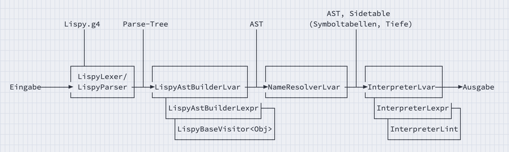

::: tldr
In L-Var fügen wir zu Lispy Variablen, Zuweisungen und Blöcke mit eigenen Scopes
hinzu. Ein L-Var-Programm durchläuft eine feste Pipeline: Quelltext $\to$
Lexer/Parser (ANTLR) $\to$ Parse-Tree $\to$ AST-Builder $\to$ AST $\to$
Name-Resolver $\to$ Interpreter.

Der AST-Builder für L-Var (`LispyAstBuilderLvar`) erweitert den AST-Builder aus
L-Expr und übersetzt den Parse-Tree in unsere abstrakte Syntax (AST).

Der Name-Resolver (`NameResolverLvar`) läuft als erster Pass über den AST, verwaltet
Scopes, prüft die Gültigkeit von Namen und trägt in den Sidetable `SemaInfo` unter
anderem die Symboltabellen als auch die Tiefeninformationen ein.

Im Interpreter (`InterpreterLvar`) als letztem Pass über den AST evaluieren wir nun
nicht nur Ausdrücke, sondern führen nun auch Statements aus und verwalten zur
Laufzeit verschachtelte Environments (`Env`). Bei Variablenzugriffen und Zuweisungen
nutzt der Interpreter die im Resolver berechneten Tiefeninformationen, um direkt das
richtige Environment zu finden, statt zur Laufzeit rekursiv suchen zu müssen.

Dieses Muster "AST $\to$ Resolver $\to$ Interpreter mit *side tables* (z.B. `depths`
in `SemaInfo`)" wird sich in den späteren Sprachstufen (L-If, L-Fun, L-Class, ...)
wiederholen. Alle Sprachstufen leiten ihre Grammatik, AST-Klassen, Resolver und
Interpreter etc. jeweils von der vorherigen Stufe ab und erweitern diese nur um die
neuen Sprachfeatures.
:::

# Pipeline-Gesamtbild für L-Var



::: notes
1.  **Lexing & Parsing** (ANTLR):
    -   Konkrete Grammatik $\to$ ANTLR-Grammatik
    -   Quelltext $\to$ Parse-Tree: `LispyLexer` & `LispyParser` (generiert)
2.  **AST-Builder**:
    -   Abstrakte Grammatik $\to$ AST-Klassen
    -   Parse-Tree $\to$ AST: `LispyAstBuilderLvar`
        -   `class LispyAstBuilderLvar extends LispyAstBuilderLexpr`
        -   Visitor-Pattern
3.  **NameResolverLvar**:
    -   `Scope`: statische Sicht (Namen $\to$ Deklarationen = Symboltabelle)
    -   AST $\to$ `SemaInfo` (Sidetable), gefüllt mit:
        -   `Map<Stmt, Scope> symbols`: Statement $\to$ Scope (Symboltabellen)
        -   `Map<VarExpr, Integer> depths`: `VarExpr` $\to$ Tiefeninformation
        -   `Scope globalScope`, `Env globalEnv`
    -   `resolve(expr)`, `resolve(stmt)` mit `switch`-Expressions und Pattern
        Matching
4.  **InterpreterLvar**:
    -   AST + `SemaInfo` $\to$ Ausführung:
        -   `Env env`: dynamische Sicht (Namen $\to$ Laufzeitwerte)
        -   `class InterpreterLvar extends InterpreterLexpr`
        -   `eval(expr)` und `exec(stmt)` nutzen `depths` für direkte
            Environment-Zugriffe
:::

# Gesamtbild im Code

``` java
var source = "(def x : int 10)  (let x (+ x 1))  (+ x 5)";

var input = CharStreams.fromString(source);
var lexer = new LispyLexer(input);
var tokens = new CommonTokenStream(lexer);
var parser = new LispyParser(tokens);
var tree = parser.lvar();

var astBuilder = new LispyAstBuilderLvar();
var ast = astBuilder.visitLvar(tree);

SemaInfo sema = new SemaInfo();
new NameResolverLvar().resolve(ast, sema);

Value result = new InterpreterLvar().interpret(ast, sema);
```

# InterpreterLvar - Rolle von `interpret(...)`

::: notes
Noch einmal der Einstiegspunkt des Interpreters ab jetzt:
:::

``` java
public class InterpreterLvar extends InterpreterLexpr {
    protected SemaInfo sema;
    protected Env env;
    protected Value last;

    public Value interpret(List<Stmt> stmts, SemaInfo semaInfo) {
        sema = semaInfo;  env = sema.globalEnv;  last = UNIT;

        stmts.forEach(this::exec);

        return last;
    }

    // protected void exec(Stmt stmt) ...
    // protected Value eval(Expr expr) ...
}
```

::: notes
-   `sema.globalEnv` kann bereits vordefinierte Funktionen/Variablen enthalten
-   `exec(stmt)` & `eval(expr)`:
    -   Deklarationen binden Werte in `env`
    -   Blocks erzeugen neue `Env`-Instanzen
    -   `VarExpr`/`AssignStmt` nutzen `sema.depths` zur Navigation
:::

# Reflexion: Muster für spätere Sprachstufen

::: notes
Das folgende Muster wird uns in L-If, L-Fun, L-Class usw. begleiten:
:::

-   **Konkrete Syntax** erweitern (ANTLR)
-   **Abstrakte Syntax** erweitern (AST, AST-Builder)
-   **Name-Resolver**:
    -   erster AST-Pass, baut Symboltabellen auf
    -   neue Prüfungen, neue Scopes (z.B. Funktions-Scopes, Klassenscopes)
    -   zusätzliche Einträge in `SemaInfo` (z.B. Funktions-Typen, Klasseninfos)
-   **Type-Checker**:
    -   weiterer AST-Pass
    -   Prüfung der Typen, statische vs. dynamische Polymorphie, ...
-   **Interpreter**:
    -   finaler AST-Pass
    -   Behandlung der neuen Features
    -   "vertraut" auf Ergebnisse von semantischer Analyse (im Sidetable)

\bigskip

**Alle Bausteine leiten jeweils von den Bausteinen der Vorgängerstufe ab.**

# Wrap-up

-   **Pipeline** L-Var:
    -   Quelltext $\to$ Lexer/Parser (ANTLR) $\to$ Parse-Tree
    -   Parse-Tree $\to$ AST (`LispyAstBuilderLvar`)
    -   AST $\to$ `SemaInfo` (`NameResolverLvar`)
    -   AST + `SemaInfo` $\to$ Ausführung (`InterpreterLvar`)
-   **Resolver** (`NameResolverLvar`):
    -   verwaltet Scopes (Symboltabellen) und prüft Namenssichtbarkeit
    -   befüllt `SemaInfo.symbols` (Statements $\to$ `Scope`)
    -   berechnet `SemaInfo.depths` für alle `VarExpr` (lexikalische Tiefe)
-   **Interpreter** (`InterpreterLvar`):
    -   führt Statements aus und evaluiert Expressions
    -   nutzt `Env`-Kette zur Laufzeit für Variablenwerte
    -   verwendet `depths` für direkten Zugriff auf richtiges Environment

\smallskip

-   **Muster**: Jede neue Sprachstufe erweitert die Bausteine der Vorgängerstufe

::: outcomes
-   k2: Ich kann den Unterschied zwischen `Scope` (statische Sicht) und `Env`
    (Laufzeitumgebung) erklären.
-   k2: Ich kann beschreiben, welche Aufgaben der `NameResolverLvar` übernimmt und
    welche der `InterpreterLvar`.
-   k3: Ich kann für ein gegebenes L-Var-Programm die Scopes und Environments
    skizzieren und erklären, wie `depths` berechnet werden.
-   k3: Ich kann einen bestehenden Resolver/Interpreter um ein einfaches neues
    Statement oder eine neue Ausdrucksform erweitern.
-   k3: Ich kann den Datenfluss in der Pipeline (Quelltext $\to$ Parse-Tree $\to$
    AST $\to$ SemaInfo $\to$ Ausführung) auf konkrete Beispiele anwenden.
-   k4: Ich kann kritisch beurteilen, welche Prüfungen sinnvoll im Resolver und
    welche im Interpreter oder Typechecker stattfinden sollten.
:::

::: challenges
**Pipeline für L-Var**

1.  Zeichnen Sie für ein kleines L-Var-Programm (eigene Wahl mit `def`, `let`,
    Block) die gesamte Pipeline als Kette von Kästen:
    -   Quelltext
    -   Parse-Tree
    -   AST
    -   Resolver (`Scope`, `SemaInfo.depths`)
    -   Interpreter (`Env`, `Value`)
2.  Markieren Sie:
    -   Wo werden **Namen gebunden**? (Resolver, `Scope.bind`)
    -   Wo werden **Werte gespeichert**? (Interpreter, `Env.define`)
    -   Wo werden **depth-Werte benutzt**?
3.  Diskutieren Sie:
    -   Welche Teile würden Sie gerne separiert vom Rest testen?

**Scopes vs. Environments für ein L-Var-Beispiel**

Gegeben sei das L-Var-Programm (vereinfacht, in Lispy-Notation):

``` clojure
(def x : int 1)
(let
  (def y : int 2)
  (assign x (+ x y)))
(+ x 10)
```

1.  Zeichnen Sie die statischen Scopes für dieses Programm (als Baum/Grafik) und
    tragen Sie ein, wo `x` und `y` deklariert werden.
2.  Skizzieren Sie die Environments zur Laufzeit:
    -   direkt nach `(def x : int 1)`
    -   innerhalb von `let` vor der Zuweisung
    -   nach der Zuweisung an `x`
3.  Überlegen Sie:
    -   Welchen `depth`-Wert bekommt der Zugriff auf `x` innerhalb des `let`-Blocks?
    -   Wie nutzt der Interpreter diesen `depth`-Wert, um das richtige `Env` zu
        finden?

**Welche Prüfung macht wer?**

Betrachten Sie die folgenden (hypothetischen) Fehlerfälle in L-Var:

-   Eine Variable wird gelesen, bevor sie deklariert wurde.
-   Eine Variable wird zweimal im gleichen Scope deklariert.
-   Eine Variable wird gelesen, ist aber in einem äußeren Scope deklariert.
-   Eine Division durch 0 tritt zur Laufzeit auf.

Diskutieren Sie in der Gruppe:

-   Welche dieser Fälle soll der Resolver erkennen? Begründen Sie.
-   Welche Fälle können nur zur Laufzeit im Interpreter erkannt werden?
-   Markieren Sie die Stellen in der Pipeline (Resolver vs. Interpreter), an denen
    Sie die jeweilige Prüfung implementieren würden.

**Tiefenberechnung verstehen**

Gegeben sei ein (vereinfachtes) L-Var-Programm:

``` clojure
(def x : int 1)
(let
  (def y : int 2)
  (let
    (def z : int 3)
    (+ x (+ y z))))
```

1.  Zeichnen Sie den AST.
2.  Überlegen Sie, welche `depth`-Werte der Resolver für die drei `VarExpr` (`x`,
    `y`, `z`) einträgt.
3.  Beschreiben Sie in 2--3 Sätzen, wie der Interpreter mit einem `depth`-Wert von
    z.B. 2 das richtige `Env` findet (ausgehend vom aktuellen `Env`).
:::
